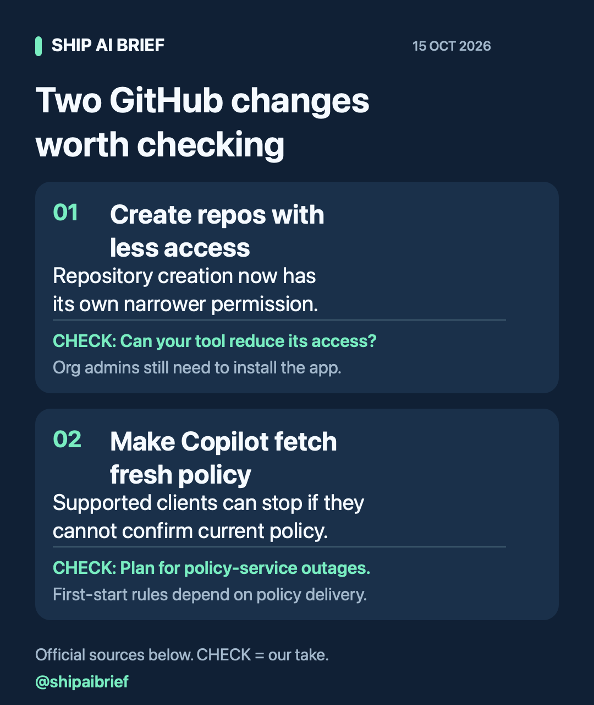

# Ship AI Brief

Small, visual briefs for developers building with AI. What changed, what to check, and where the claim comes from.

[Read on Telegram](https://t.me/shipaibrief) | [Browse the public channel](https://t.me/s/shipaibrief)

## Latest brief - 15 October 2026

### GitHub app permissions: check your repository creation scope

GitHub announced a separate `repository_creation:write` permission on 13 October. Apps that create repositories can request a narrower permission than general repository administration. An organization administrator still needs to install the app.

Our take: if your integration asks for administration only because it creates repositories, review whether the new permission covers that use. Do not remove permissions your other operations still need.

A quick review:

- List the repository operations your app actually performs.
- Separate creation from operations that still require administration.
- Check the permission definitions for each operation before changing the app.
- Test the revised permission request in a disposable organization or repository.
- Check the changelog's availability notes if you use GitHub Enterprise Server.

[Original GitHub changelog](https://github.blog/changelog/2026-10-13-github-app-improvements-for-least-privilege-and-management/)

### Copilot policy: plan for failed refreshes

GitHub announced `forceRemoteSettingsRefresh` on 13 October. Supported Copilot clients can refuse to continue when they cannot confirm current enterprise policy. A server-delivered setting applies on subsequent startups after the client has received it. Device management or file-delivered settings can apply from first startup.

Our take: if you enforce this setting, include policy-service outages in rollout testing. Do not assume every client or deployment method has identical first-start behavior.

[Original GitHub changelog](https://github.blog/changelog/2026-10-13-enterprise-managed-settings-enforcement-updates/)

## Editorial approach

Up to three worthwhile stories in a weekday digest. Original summaries, official source links and clear limitations. CHECK on a card means our assessment. Announcements and vendor claims are labelled; we do not claim hands-on tests we have not performed.

This channel launched on 15 October 2026. We are collecting reader feedback, not claiming an established audience. If this brief helps a colleague, [forward the Telegram post](https://t.me/shipaibrief/3).

Corrections and suggestions can be submitted as repository issues. Please include a source link.
