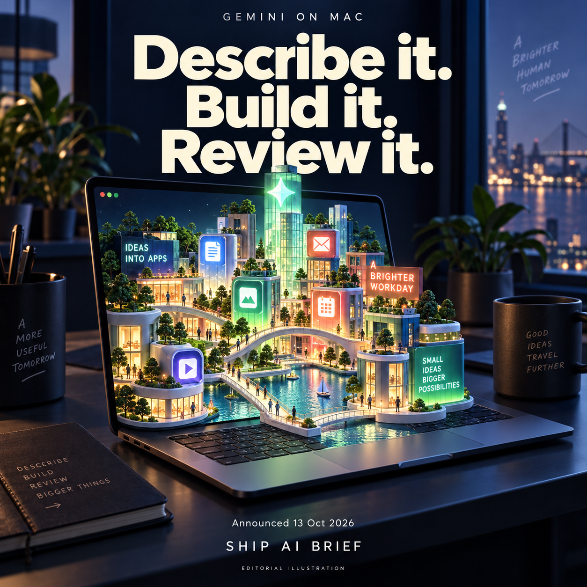
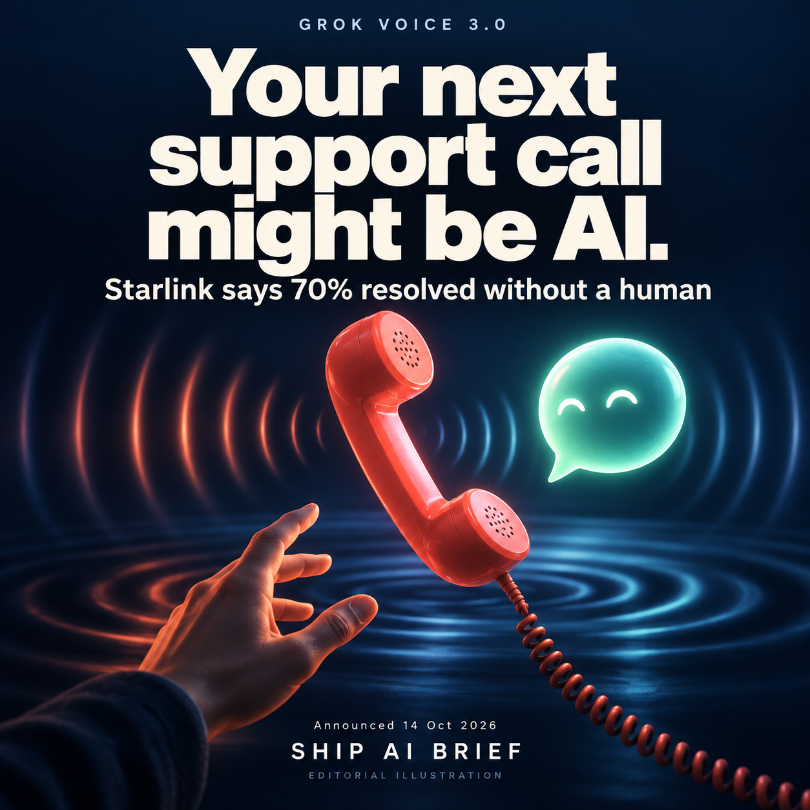
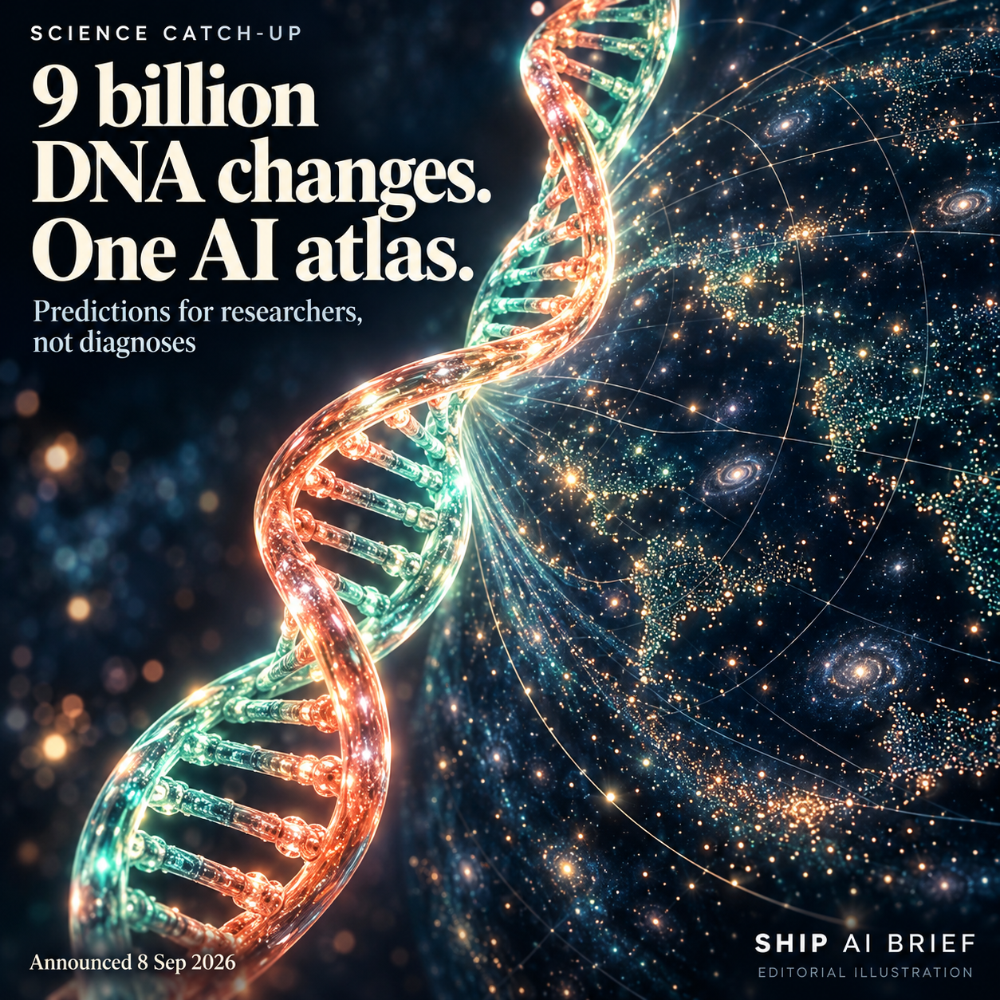

# Ship AI Brief

The useful launches, surprising discoveries and big AI shifts worth knowing about. Big visuals. Short reads. The catch included.

[Follow on Telegram](https://t.me/shipaibrief) | [Visual preview](https://colaps1s.github.io/ship-ai-brief/)

## A better starting point - 15 October 2026

### Describe it. Build it. Review it.

Have an app idea stuck in Notes? Google has added Antigravity to Gemini on Mac: approve a plan and a coding agent builds and tests in the background. Our take: a shorter path to a first prototype, with human review still essential. English, ages 18+, eligible accounts and supported regions. Announced 13 Oct 2026; we have not tested it hands-on.

[Original source](https://gemini.google/release-notes/?hl=en) | [Telegram post](https://t.me/shipaibrief/7)

### Your next support call might be AI.

Grok Voice 3.0 launched on 14 Oct. Its announcement says Starlink uses Grok Voice for 20,000 calls a day, with roughly 70% resolved without a human. Those are company-reported figures for Grok Voice in use, not a measured improvement from the new release. Our take: fixing the problem matters more than sounding human.

[Original source](https://x.ai/news/grok-voice-3) | [Telegram post](https://t.me/shipaibrief/8)

### 9 billion DNA changes. One AI atlas.

Science catch-up, announced 8 Sep 2026. AlphaGenome Atlas maps predictions for 9 billion possible single-letter DNA changes, with a free academic research portal. Our take: it helps researchers choose what to investigate in the lab. Predictions are not diagnoses or cures; the tool is not approved for clinical use.

[Original source](https://deepmind.google/blog/alphagenome-atlas-a-predictive-map-of-every-possible-dna-letter-change-in-the-human-genome/) | [Telegram post](https://t.me/shipaibrief/9)

## How we choose stories

One weekday digest, up to three good stories. A new capability people can use, a meaningful price change, a surprising discovery, or a failure with consequences. Original sources and announcement dates, company claims labelled, no invented hands-on tests. Older catch-ups are clearly dated. Images are original AI-generated editorial illustrations.

The narrow launch issue remains in the [archive](issues/2026-10-15-original.md).

Corrections and suggestions are welcome through repository issues.
